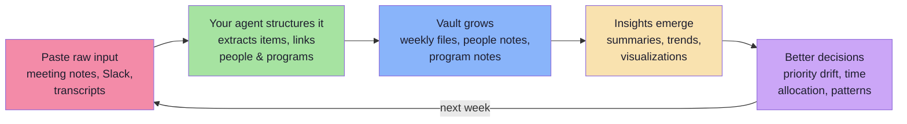

# obsidian-worklog

> __Netflix-internal fork.__ This is the Netflix variant of [`menottim/obsidian-worklog`](https://github.com/menottim/obsidian-worklog). It adds Netflix-specific MCP integrations and three new commands (`/worklog ingest`, `/worklog whois`, `/worklog jira`) on top of the public skill. If you're at Netflix, start with [`docs/SETUP-NETFLIX.md`](docs/SETUP-NETFLIX.md) after the standard setup below.

A skill for [Claude Code](https://claude.ai/claude-code) and [Codex](https://learn.chatgpt.com/docs) that turns your Obsidian vault into a structured worklog with weekly planning, a people and program knowledge graph, priority tracking, D3 visualizations, and AI-powered summaries.

It's built for anyone juggling work across a lot of projects and people. You paste in the raw stuff (meeting notes, Slack threads, transcripts) and your coding agent pulls out the action items, links the people and programs involved, and files everything under the right week. Do that for a few months and the vault becomes a searchable record of what you worked on and who you worked with.

## Table of Contents

- [What You Get](#what-you-get)
- [The Workflow](#the-workflow)
- [Prerequisites](#prerequisites)
- [Quick Start](#quick-start)
- [How It Works](#how-it-works)
- [Vault Structure](#vault-structure)
- [Commands](#commands)
- [Working with Raw Input](#working-with-raw-input)
- [The Knowledge Graph](#the-knowledge-graph)
- [Dataview Queries](#dataview-queries)
- [Customization](#customization)
- [File Format Examples](#file-format-examples)
- [FAQ](#faq)
- [License](#license)

## What You Get

- **Weekly planning** with Monday rollover workflow and mid-week updates
- **Priority tracking** (P0/P1/P2) with status markers and dated progress notes
- **Knowledge graph** that auto-links people, programs, and teams across every note
- **Periodic summaries** (week/month/quarter) with priority drift analysis and trend detection
- **D3.js visualizations** of time allocation, program activity, and completion rates
- **Vault health checks** that find stale notes, stuck items, missing links, oversized notes, and drift in your team vocabulary and recurring topics
- **Preferences as first-class citizens** -- the skill maintains a `Preferences/` directory as its general-purpose memory layer: voice, style, workflow, tooling, decision rules, vault conventions, anything durable about how you work, captured once and applied automatically across sessions
- **Slack inbox** -- register Slack channels as sources and let `/worklog pull` sweep them into your current week. Three kinds of source are supported: forwarded-email meeting notes (one `Meetings/` note per thread), busy discussion channels (swept and folded in place, no per-thread files), and your own DMs (opt-in, never folded without your approval). Incremental pull requires a Slack connector that can enumerate channels and threads; auto-fetch for email bodies needs a one-time Slack token (see [`docs/SETUP-SLACK.md`](docs/SETUP-SLACK.md)); the [FAQ](#faq) covers the rest
- **Operations log** -- an append-only `Logs/YYYY-MM.md` record of what the skill did and when (pulls, rollovers, tidies, syncs), so "was the last pull complete" is answered by grep, not memory
- **Entity summaries** -- People and Program notes carry a one-line `summary` (authored or derived), so the cross-link digest can tell you who or what something is without opening the note
- **Filed answers** -- substantive analysis and weekly rollups can be filed to `References/` as durable, cross-linked vault artifacts instead of evaporating as a one-off chat reply or Slack paste


## The Workflow

It works as a loop: you put raw input in, structured notes come out, and each new week builds on the last.



**Monday:** `worklog rollover` starts a new week, carries forward unfinished items.
**During the week:** Paste meeting notes, Slack messages, transcripts. The agent extracts items, links people and programs, dates everything.
**Anytime:** `worklog summary` or `worklog viz` shows where your time went.
**The graph grows:** Every person and program gets a note. Backlinks connect everything. Click any person to see every week they appeared in.

## Prerequisites

- [Claude Code](https://claude.ai/claude-code) or [Codex](https://learn.chatgpt.com/docs)
- [Obsidian](https://obsidian.md/) (any recent version)
- An Obsidian vault (existing or new -- `setup.sh` can create the structure for you)
- Recommended Obsidian plugins (install from Community Plugins):
  - **Templater** -- auto-fills dates in weekly file templates
  - **Periodic Notes** -- "Open weekly note" command + Calendar integration
  - **Calendar** -- sidebar calendar, click a week number to open that week
  - **Dataview** -- live query tables from your worklog frontmatter

## Quick Start

The workflow is shared across both hosts. Invocation syntax differs:

| Host | Explicit invocation | Example |
|------|---------------------|---------|
| Claude Code | `/worklog` | `/worklog status` |
| Codex CLI / IDE | `$worklog` | `$worklog status` |

### Claude Code

```bash
# 1. Clone the repo
git clone https://git.netflix.net/mminutillo/obsidian-worklog.git
cd obsidian-worklog

# 2. Run the interactive setup (configures paths, name, git identity)
./setup.sh

# 3. Copy to your Claude Code plugins directory
cp -r . ~/.claude/plugins/marketplaces/personal/plugins/obsidian-worklog

# 4. Restart Claude Code, then try it
```

> __Upgrading an existing install: bump the version first.__ Claude Code caches the plugin
> under `~/.claude/plugins/cache/<marketplace>/obsidian-worklog/<version>/`, keyed by the
> `version` in `.claude-plugin/plugin.json`. Copying new files over an unchanged version
> number leaves the old build running, and nothing warns you. So on every upgrade: bump
> `version`, copy, then restart Claude Code. To confirm what is actually running, read
> `~/.claude/plugins/installed_plugins.json` and check the `version` and `installPath` for
> `obsidian-worklog` rather than trusting the repo.

```
/worklog status
```

If no current week file exists, Claude will tell you. Run `/worklog rollover` to create your first week.

### Codex

```bash
# 1. Clone the repo
git clone https://git.netflix.net/mminutillo/obsidian-worklog.git
cd obsidian-worklog

# 2. Render a Codex bundle and expose its skill through ~/.agents/skills
./setup-codex.sh

# 3. Start a new Codex session with your vault available as a writable workspace
```

Then try:

```text
$worklog status
```

If no current week file exists, run `$worklog rollover`. See
[`docs/SETUP-CODEX.md`](docs/SETUP-CODEX.md) for installation, permissions,
upgrades, and Netflix MCP notes.

### What setup.sh does

The setup script walks you through configuration:
- Asks for your Obsidian vault path (validates it exists, or offers to create the directory structure)
- Asks for your display name and git identity
- Optionally configures a git backup repo
- Copies the weekly template into your vault's `Templates/` directory

### Configure Obsidian plugins

Install each plugin from Settings -> Community Plugins -> Browse. After installing, toggle each one __ON__, then click the gear icon to configure.

#### Templater

| Setting | Value |
|---------|-------|
| Template folder location | `Templates` |
| Trigger Templater on new file creation | ON |
| Enable folder templates | ON |

Then under __Folder Templates__, add one entry:

| Folder | Template |
|--------|----------|
| `Worklogs` | `Templates/Weekly.md` |

This auto-fills the `tp.date` and `tp.file.title` expressions whenever a new file is created in `Worklogs/`.

#### Periodic Notes

| Setting | Value |
|---------|-------|
| __Weekly Notes__ | |
| Enable weekly notes | ON |
| Format | `YYYY-[W]WW` |
| Weekly note template | `Templates/Weekly.md` |
| Weekly note folder | `Worklogs` |

Leave daily, monthly, quarterly, yearly __disabled__ (the worklog skill handles those).

#### Calendar

| Setting | Value |
|---------|-------|
| Show week numbers | ON |
| Start week on | Monday |
| Confirm before creating new note | ON |

Calendar picks up weekly note settings from Periodic Notes. Clicking a week number in the sidebar opens or creates that week's file.

#### Dataview

| Setting | Value |
|---------|-------|
| Enable JavaScript Queries | ON |
| Enable Inline Queries | ON |

Everything else default. See [docs/dataview-queries.md](docs/dataview-queries.md) for ready-to-paste queries.

#### How the plugins work together

Calendar sidebar -> click week number -> Periodic Notes creates the file -> Templater fills in dates from the template -> Dataview queries pull live stats from frontmatter.

## How It Works

This is an agent skill: a markdown file ([SKILL.md](skills/worklog/SKILL.md)) that Claude Code or Codex reads as instructions. There is no worklog runtime, server, or API. The agent reads your vault files directly, follows the instructions to structure and link content, and writes the results back. The skill defines the file formats, linking conventions, and command behaviors. To keep token cost low, worklog audit and preference application use bundled read-only scanner scripts in `skills/worklog/scripts/`, and less-common command detail (viz, the Netflix commands, the full pull flow) is loaded on demand from `skills/worklog/references/` rather than included in every invocation.

### The model guard

A few commands are heavy single-shot synthesis over a large vault: pull, tidy, viz, a quarterly summary, and processing a full transcript. Claude Code retains the existing advisory Opus model guard. Codex proceeds on its configured model and reasoning level; for unusually large vaults, choose a more capable model or higher reasoning effort before retrying a truncated result.

## Vault Structure

The skill organizes your vault into these directories:

```
Your Vault/
  Worklogs/       One file per week (YYYY-[W]WW.md) + Backlog.md
  People/         One note per person, wiki-linked
  Programs/       One note per program/initiative, wiki-linked
  Teams/          One note per team, links members + parent org (optional)
  Preferences/    One note per durable preference (voice, style, workflow, etc.)
  Sources/        Registered Slack channels for `/worklog pull`. One file per channel; frontmatter holds `type` (which selects the sweep behavior), `channel_id`, `last_scan_ts`, and nudge threshold.
  Meetings/       One file per ingested Slack thread (top-of-thread email + in-thread discussion). Linked into the knowledge graph via wiki-linked participants and programs.
  Logs/           Append-only operations log (one file per month)
  Archive/        Completed weeks in compact summary format
  Summaries/      Weekly, monthly, quarterly summaries
  References/     Durable filed artifacts: weekly rollups, handover docs, filed answers
  Reports/        D3 visualization HTML files
  Templates/      Templater weekly template
```

`Teams/` adds a third dimension to the knowledge graph beyond People and Programs.
Set `team:` in a person's frontmatter to associate them, and `parent:` in a team's
frontmatter to link sub-teams under a larger org.

`team:` is a __controlled vocabulary__, not free text. A value must either match a
`Teams/` note name exactly or be one of four reserved values: `External`,
`Former Netflix`, `Unknown`, or `Partner`. Free text defeats the point of the property,
since the Teams dimension only works when `team:` resolves to a note. Write `Unknown`
rather than inventing a label. `/worklog audit` reports the distribution of `team:`
values against your `Teams/` notes so drift is visible.

`Preferences/` is the skill's general-purpose memory layer. Anything durable the
skill discovers about how you work goes here - voice and communication patterns,
markdown style, workflow rules, tool choices, decision heuristics, vault
conventions, defaults you want confirmed before action. The skill checks this
directory before any task with a preference-shaped surface (drafting messages,
writing markdown, picking tools, structuring notes), and offers to capture new
preferences when you give feedback that sounds durable.

Each weekly file uses YAML frontmatter with enriched fields that are auto-generated from the body:

```yaml
programs:    # wiki-linked programs mentioned in this week
people:      # wiki-linked people mentioned
tags:        # inferred from subgroup headings
item-count:  # total priority items
done-count:  # completed items
```

These fields enable [Dataview queries](docs/dataview-queries.md) for live dashboards inside Obsidian.


## Commands

The table uses Claude Code's `/worklog` spelling. In Codex, replace it with
`$worklog`; the command names and arguments are otherwise the same.

| Command | What it does |
|---------|-------------|
| `/worklog` | Show active items grouped by priority |
| `/worklog review` | Monday morning item-by-item review (updates current week in place) |
| `/worklog rollover` | Create new week, archive previous, carry forward unfinished items |
| `/worklog add P1 <title>` | Quick-add an item, checks for overlaps |
| `/worklog pull` | Sweep registered Slack channels and fold new context into the current week. Email-notes channels become per-thread `Meetings/` notes; context channels fold in place. On first run with no `Sources/`, walks you through registering one. |
| `/worklog tidy` | Cleanup suggestions: move done items, flag stuck items, dedup |
| `/worklog audit` | Vault health check with fix-it checklist |
| `/worklog compact [note]` | Fold an oversized note's old history into a summary, one note at a time |
| `/worklog search <term>` | Search across all vault files |
| `/worklog share` | Slack-ready summary copied to clipboard |
| `/worklog rollup` | IC-facing weekly context dump for a broad team channel; also filed to `References/` |
| `/worklog file [title]` | File the answer you just produced into `References/` as a durable, cross-linked artifact |
| `/worklog summary [period]` | Impact summary for reporting up (week/month/quarter) |
| `/worklog viz [period]` | D3.js charts as standalone HTML |
| `/worklog sync` | Git backup: commit and push |

### Netflix-specific commands (this fork only)

These require Netflix-internal MCPs - see [`docs/SETUP-NETFLIX.md`](docs/SETUP-NETFLIX.md) for installation and [`docs/NETFLIX-COMMANDS.md`](docs/NETFLIX-COMMANDS.md) for full reference.

| Command | What it does |
|---------|--------------|
| `/worklog ingest <url>` | Fetch a Coda / Confluence / Google Doc / Slack-thread URL through the current host's Netflix MCP binding, then process its body as raw worklog input |
| `/worklog whois <name>` | Resolve a person via Netflix's employee directory, then create/enrich their `People/` note with title, manager, and team |
| `/worklog jira <key>` | Pull a Jira ticket's current state via the Atlassian MCP, add it as a worklog item under the right subgroup |

Host support for the Netflix integrations is additive:

| Capability | Claude Code | Codex |
|------------|-------------|-------|
| Core file-based worklog commands | Supported | Supported |
| One-off Slack, internal-doc, employee, and Jira ingestion | Existing Claude MCP bindings | Codex Core Tools and Atlassian Rovo adapter |
| Incremental Slack channel pull | Requires the existing Slack connector | Requires a connector that can list channel messages, read threads, resolve channels, and resolve users |

Codex will not substitute Slack semantic/RAG search for incremental enumeration because
RAG results are not exhaustive enough to advance a source cursor safely. It stops without
changing pull state and offers one-off `$worklog ingest <slack-permalink>` instead. See
[`docs/SETUP-CODEX.md`](docs/SETUP-CODEX.md) for details.

### Key commands in detail

**`/worklog review`** -- Walks through each active item for quick status updates ("done", "still on it", "pinged Sarah"). Collects new items. Updates the current week file in place. Does _not_ create a new week or archive anything. Use `/worklog rollover` for that.

**`/worklog summary [period]`** -- Generates an impact-oriented summary for reporting up. Accepts: `week`, `month`, `quarter`, or specific references like `W20`, `March`, `Q1`. Monthly and quarterly summaries include **Priority Drift** (how P0s shift over time) and **Trends** (time allocation, completion rates). Writes a wiki-linked vault file and copies a plain-text version to clipboard.

**`/worklog rollup`** -- Generates an IC-appropriate context dump of the current week for posting to a broad team channel (e.g. `#eng-all`). Organized into two buckets: _Stuff you should probably know_ (program-level updates, structural decisions, paved-road changes, things ICs can act on) and _Context: everything else_ (FYI-grade one-liners). Filters out performance commentary, 1:1 specifics, hiring candidate details, and other leader-only context. Slack-mrkdwn formatted and copied to the clipboard with wiki-links stripped; also filed to `References/YYYY-WNN Rollup.md` with wiki-links kept so it lands in the graph.


**`/worklog audit`** -- Scans the vault for stale people notes (not mentioned in 4+ weeks), orphan programs, stuck items (3+ weeks without progress), missing wiki-links, empty stubs, and frontmatter gaps, plus three wider reports: notes that have grown past the compaction threshold, the distribution of `team:` values against your `Teams/` notes, and tags that recur across weeks without a page of their own. The first six are findings you pick fixes from. The last three are tables to read and judge, not to-do lists.

**`/worklog compact [note]`** -- Folds an oversized note's old history into a `## History` summary so it stops growing without bound. Refuses outright on a vault that isn't a clean git working tree -- there's no undo for a lossy fold otherwise. Shows you the proposed fold and waits for approval before writing anything. Three checks run against the proposal before it lands: a __link gate__ (no `[[wiki-link]]` target disappears without being named to you and explicitly confirmed), a __heading gate__ (every heading that vanishes must be one you can point at a named `## History` bullet for -- this catches a silently truncated rewrite that the link gate cannot see), and a __line-count reconciliation__ after the write (the note's total drop must not exceed what the folded sections account for). If a note is still over the threshold afterward, says so rather than marking it done.

Two environment variables tune it:

| Variable | Default | What it does |
|----------|---------|--------------|
| `WORKLOG_COMPACT_KEEP_DAYS` | `60` | Dated entries newer than this move to `## Recent` unchanged; older ones fold into `## History` bullets |
| `WORKLOG_COMPACT_LINES` | `250` | The line count above which `/worklog audit` reports a note as oversized |

The 60-day default is deliberate. On a vault whose mass sits in the last three months, a 90-day window folds almost nothing, so the pass reports "still oversized" and you run it twice. Raise it if your notes accumulate more evenly.

**`/worklog viz [period]`** -- Generates a standalone HTML file with four D3.js charts: time allocation pie, program activity heatmap, P0 trend line, and completion rate bars. Open in any browser. Dark theme, responsive layout.

## Working with Raw Input

The most common workflow: paste meeting notes, Slack threads, or transcripts directly into the conversation and ask the agent to add them to the worklog.

The agent will:
- Extract action items and decisions
- Match against existing items (adds sub-items, avoids duplicates)
- Wiki-link people and programs (creating stubs for new ones)
- Add dated annotations from the source content
- Update the current week file

Example:

```
here are notes from my 1:1 with Sarah:
- she's concerned about the migration timeline slipping
- wants to bring in a contractor for the gap
- Marcus is doing well picking up Dev's work

add to worklog
```

The agent adds these as sub-items under the existing migration item, wiki-links Sarah Chen and Marcus Williams, and dates the annotations.

## The Knowledge Graph

Every time the skill writes to the vault, it wiki-links all people, programs, and teams. This builds a dense knowledge graph in Obsidian:

- Click any person's note to see every week they appeared in (via backlinks)
- Click any program to see its full history across weeks
- Click any team to see its members and the work flowing through it
- The graph view shows how people, programs, and teams cluster together

**People notes** (`People/Sarah Chen.md`) accumulate context over time: role, relationship, what you're working on together. New bullet points are added as substantive updates happen. The optional `team:` frontmatter property links a person to a team note.

**Program notes** (`Programs/Platform Migration.md`) track status evolution, key decisions, and who's involved.

**Team notes** (`Teams/Platform.md`) capture team membership and the work the team owns. The optional `parent:` frontmatter property links sub-teams to their parent org, so the graph can model nested team structures.

**Preference notes** (`Preferences/Markdown Formatting.md`, `Preferences/Slack DM Voice.md`, `Preferences/Commit Discipline.md`, ...) are the skill's general-purpose memory for how you work. One note per preference: voice, style, workflow, tooling, decision rules, vault conventions, anything you want to remember and apply later. The active agent reads these before any task with a preference-shaped surface, so your working style stays consistent across sessions instead of drifting back to a generic LLM default.

The skill creates stub notes for new people, programs, and teams automatically. The graph grows organically as your worklog evolves.


## Dataview Queries

With the Dataview plugin enabled, you can create live dashboards inside Obsidian. See [docs/dataview-queries.md](docs/dataview-queries.md) for 8 ready-to-paste queries covering weekly overviews, people engagement, program frequency, completion rates, and more.

## Customization

### Subgroups

Weekly files use bold labels for thematic subgroups that adapt to your work:

```markdown
**Platform & Infrastructure**

- **P0** ⏳ In Progress - Platform migration cutover planning
  - Confirmed rollback window with Sarah Chen (May 12)

**Hiring & People**

- **P1** ⏳ In Progress - Backend engineer pipeline
```

Common patterns: by domain, by team, by initiative type. The skill reorganizes them during review if themes shift.

### Priority levels

| Level | Meaning |
|-------|---------|
| **P0** | Must happen this week, blocking or critical |
| **P1** | Important, actively working on |
| **P2** | Tracking but not urgent, visibility items |

### Status markers

| Marker | Meaning |
|--------|---------|
| ⏳ In Progress | Actively working on |
| ✅ Done | Completed |
| 🔁 Ongoing | Recurring, no end date |

## File Format Examples

All files are standard Obsidian-compatible markdown with YAML frontmatter. See the [examples/](examples/) directory:

- [Weekly file](examples/weekly-file.md) -- active week with items and subgroups
- [Archive file](examples/archive-file.md) -- compact summary of a completed week
- [Person note](examples/person-note.md) -- accumulated context about a person
- [Program note](examples/program-note.md) -- program status over time
- [Summary file](examples/summary-file.md) -- period summary with drift and trends
- [Source note](examples/source-note.md) -- registered Slack channel config with frontmatter fields
- [Meeting note](examples/meeting-note.md) -- ingested Slack thread with discussion and extracted action items


## FAQ

**Do I need Obsidian to use this?**
The skill reads and writes plain markdown files, so technically no. But Obsidian's graph view, backlinks, and Dataview plugin are what make the knowledge graph and dashboards useful.

**Does this work with existing vaults?**
Yes. The skill creates its own directories (Worklogs/, People/, Programs/, etc.) within your vault. It won't touch your existing notes.

**How do I handle multiple projects?**
Use thematic subgroups within each week. The skill adapts subgroup labels to your current work, so you don't need separate vaults or files per project.

**Can I edit files directly in Obsidian?**
Absolutely. The skill reads the current file state before every change. Edit freely in Obsidian between agent sessions.

**What happens if I miss a weekly rollover?**
Nothing breaks. Run `/worklog rollover` whenever you're ready. The old week stays in Worklogs/ until you roll it over.

**How much does the vault grow?**
Each week adds ~2-5 KB. After a year: 52 weekly files + 50-100 people + 20-30 programs = a few hundred KB total.

**How do I add a new Slack channel to monitor?**
Run `/worklog pull` (or `$worklog pull` in Codex). If `Sources/` is empty, the skill walks you through registering the channel: it asks for the channel name, resolves the channel ID via Slack search, writes a `Sources/<channel>.md` config file, and runs the first pull. To add another channel later, just say "register `#another-channel` as a source" (a raw channel ID works too). The active host must expose channel-listing, thread-reading, channel-resolution, and user-resolution capabilities; Codex reports any missing capability without changing the source cursor.

**How do I set up auto-fetch for email bodies?**
See [`docs/SETUP-SLACK.md`](docs/SETUP-SLACK.md) for a 5-minute walkthrough: register a personal Slack app at `api.slack.com/apps` with `files:read` scope, install it to your workspace, store the `xoxp-` user token at `~/.config/obsidian-worklog/slack-token` (chmod 600), and drop in a small `slack-fetch-file` helper script. After that, `/worklog pull` ingests email bodies automatically. If your workspace requires admin approval for new apps, the manual-paste fallback keeps the feature working while you wait.

**What if auto-fetch isn't set up?**
The skill falls back to prompting you to paste each email body inline. Same outcome (`Meetings/` note + action items extracted), just one extra step per thread. You can also say `skip` to advance past a thread without ingesting it, or `skip all remaining` to bail out of the entire pull while preserving un-shown threads for the next run. No skeleton notes get created, so the vault stays clean.

**What if I delete a meeting note by accident?**
The next `/worklog pull` will re-ingest it (auto-fetch path) or re-prompt you to paste (manual path), since the `slack_thread_ts` no longer matches anything in `Meetings/*.md` and the thread is treated as new. To permanently skip a thread, use `skip` in the manual-paste prompt; that advances `last_scan_ts` past it.

**What if I edit a meeting note?**
Your edits are preserved. Subsequent pulls only append new thread replies under `## Discussion` and update `slack_last_reply_ts` in the frontmatter. The `## Notes` section and anything else you add is never overwritten.

**What's the difference between the three Slack source types?**
`meeting-notes-via-email` treats one forwarded-email thread as one meeting and saves a `Meetings/` note per thread. `context-channel` sweeps a busy discussion channel since the last pull, auto-folds high-confidence matches into the items they relate to (with a Slack permalink), asks before adding anything new or uncertain, and drops noise, with no per-thread files. `dm-sweep` is a single `Sources/_dms.md` covering all your 1:1 and group DMs at once (they are searched, not enumerated, so there is no per-conversation state); nothing it finds is ever auto-folded, and approved items are written as genericized summaries. Every uncertain or new candidate from context channels and DMs lands in one approval batch at the end of the pull, presented one item at a time.

**Does the pull read my DMs?**
Only if you opt in with `Sources/_dms.md` and install the `slack-search-dms` helper (plus the search scopes and DM-search consent). Even then, no DM content is ever written without your explicit approval, and approved items are genericized (no verbatim quotes) with a private Slack permalink.

## License

MIT -- see [LICENSE](LICENSE).
