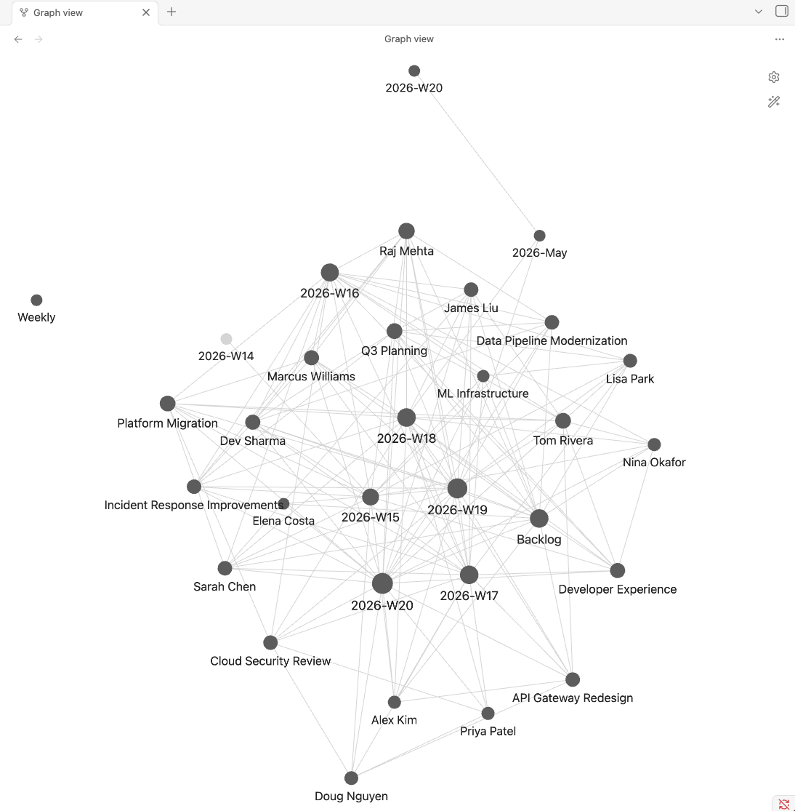
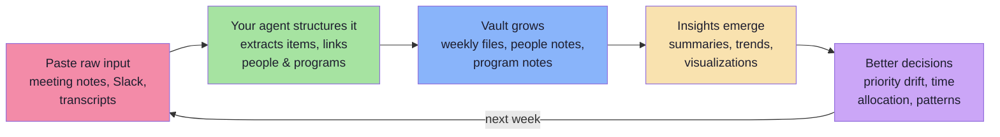
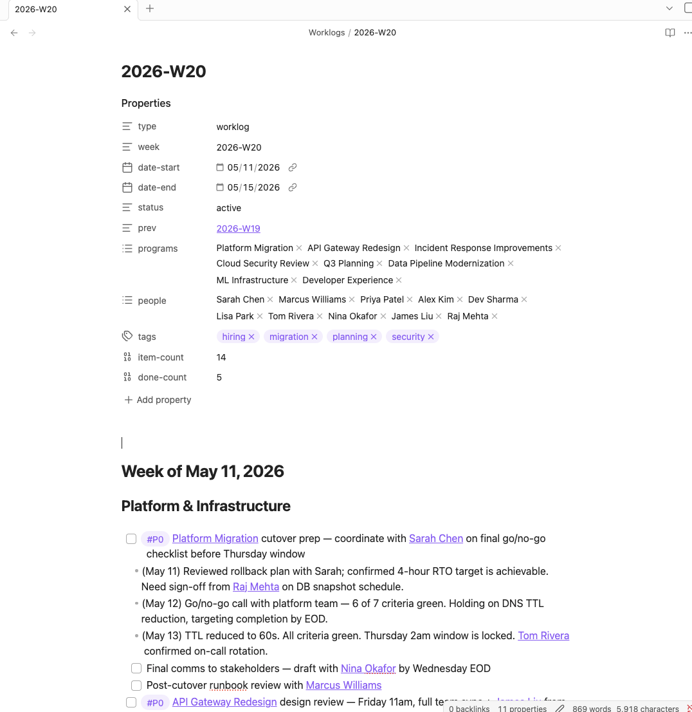
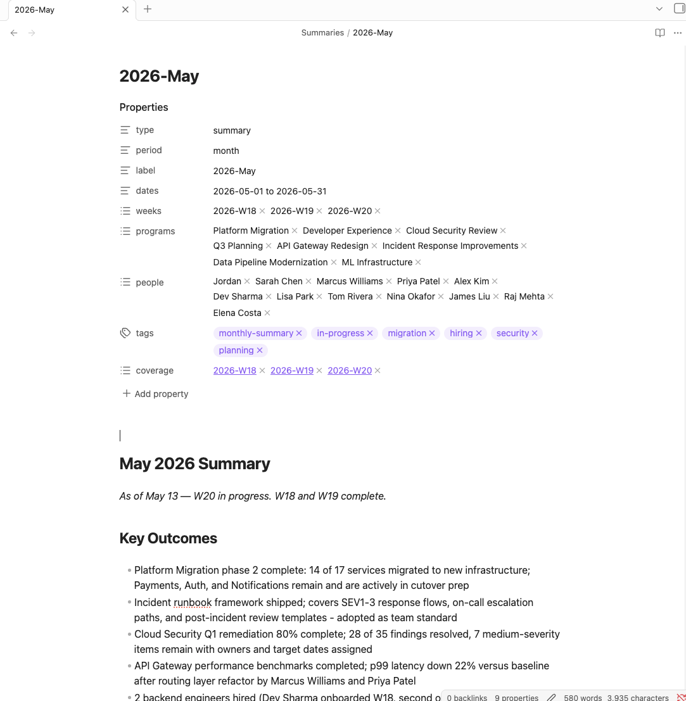
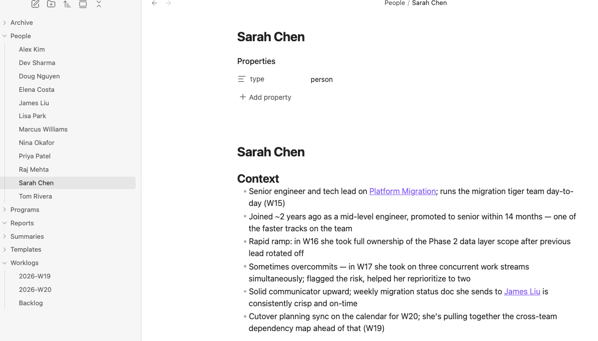
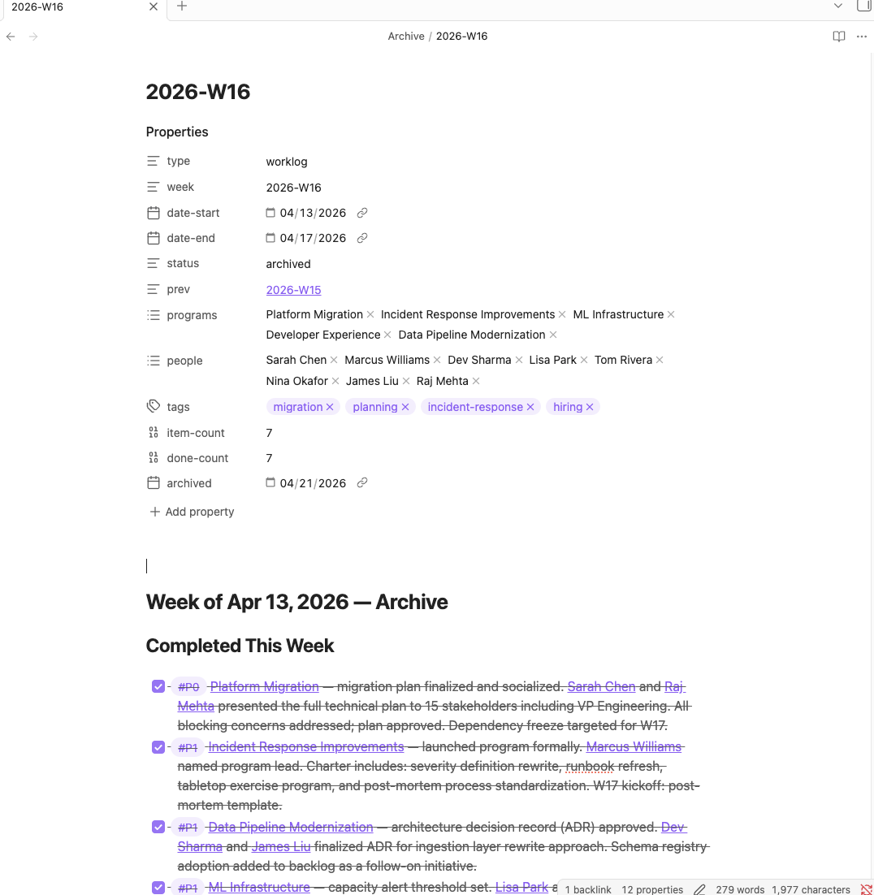

# obsidian-worklog

A skill for [Claude Code](https://claude.ai/claude-code) and [Codex](https://learn.chatgpt.com/docs). It turns your Obsidian vault into a structured worklog. You get weekly planning, priority tracking, a knowledge graph of people and programs, period summaries, and D3 visualizations.

The skill is for people who work across many projects and with many people. You paste raw input (meeting notes, Slack threads, transcripts). The agent finds the action items, links the people and programs, and files each item in the correct week. After some months, the vault is a searchable record of your work and the people you worked with.

## Table of Contents

- [What You Get](#what-you-get)
- [The Workflow](#the-workflow)
- [Prerequisites](#prerequisites)
- [Quick Start](#quick-start)
- [How It Works](#how-it-works)
- [Vault Structure](#vault-structure)
- [Commands](#commands)
- [Working with Raw Input](#working-with-raw-input)
- [The Knowledge Graph](#the-knowledge-graph)
- [Dataview Queries](#dataview-queries)
- [Customization](#customization)
- [File Format Examples](#file-format-examples)
- [Development and Testing](#development-and-testing)
- [FAQ](#faq)
- [License](#license)

## What You Get

- **Weekly planning**: a Monday rollover and updates during the week.
- **Priority tracking**: P0, P1, and P2 items with status markers and dated progress notes.
- **Knowledge graph**: the skill links people, programs, and teams in every note that it writes.
- **Period summaries**: week, month, and quarter. Month and quarter summaries show priority drift and trends.
- **D3.js visualizations**: time allocation, program activity, P0 trend, and completion rates.
- **Vault health checks**: the audit finds stale notes, stuck items, missing links, oversized notes, and drift in team names and recurring tags.
- **Threads**: each long-running item keeps its full dated history in a `Threads/` note. The week file shows only the newest updates, so it stays short.
- **Cold storage**: `/worklog cold` moves old history from People, Programs, and Threads notes to `Cold/`. The move is verbatim, so no text is lost.
- **Preferences**: the `Preferences/` directory is the memory of the skill. It holds durable facts about how you work (voice, style, workflow, tools, decision rules, vault conventions). The skill applies them in each session.
- **Slack inbox**: register Slack channels as sources. `/worklog pull` then adds new messages to the current week. The [Slack source types](#slack-source-types) section describes the three types. Incremental pull needs a Slack connector that can list channels and read threads. The automatic fetch of email bodies needs a Slack token (see [`docs/SETUP-SLACK.md`](docs/SETUP-SLACK.md)).
- **Optional integrations**: `/worklog ingest <url>` reads a Slack thread, a Confluence page, or a Google Doc. `/worklog jira <key>` adds a Jira ticket as an item. Both use MCP servers that you connect.
- **Operations log**: `Logs/YYYY-MM.md` records each operation that writes the vault (pulls, rollovers, tidies, syncs). The log is append-only. To find the last complete pull, use grep.
- **Auto sync** (optional): after each command that writes the vault, the skill commits and pushes the vault to your backup repo. It prints one line with the result.
- **Entity summaries**: each People and Program note has a one-line `summary`. The link index uses it to identify an entity without opening the note.
- **Filed answers**: you can file a substantive analysis or a weekly rollup to `References/`. The skill links the filed note into the graph.



## The Workflow

The workflow is a loop. Raw input goes in, structured notes come out, and each week builds on the last week.



- **Monday:** `/worklog rollover` starts a new week. It carries forward the items that are not done.
- **During the week:** paste meeting notes, Slack messages, and transcripts. The agent extracts items, links people and programs, and adds dates.
- **At any time:** `/worklog summary` or `/worklog viz` shows where your time went.
- **Over time:** each person and program gets a note. Backlinks connect the notes. Open a person's note to see each week that mentions that person.

## Prerequisites

- [Claude Code](https://claude.ai/claude-code) or [Codex](https://learn.chatgpt.com/docs).
- `git`, `bash`, and `jq`. The setup scripts and the bundled scripts run on the bash 3.2 that macOS supplies. The audit, link-index, and preferences scripts need `jq`.
- [Obsidian](https://obsidian.md/) (a recent version).
- An Obsidian vault. You can use an existing vault, or `setup.sh` can create a new one.
- Recommended Obsidian community plugins:
  - **Templater**: fills in the dates in new weekly files.
  - **Periodic Notes**: adds the "Open weekly note" command and works with Calendar.
  - **Calendar**: shows a calendar in the sidebar. Click a week number to open that week.
  - **Dataview**: shows live query tables from the worklog frontmatter.

## Quick Start

The workflow is the same on both hosts. Only the invocation syntax is different:

| Host | Explicit invocation | Example |
|------|---------------------|---------|
| Claude Code | `/worklog` | `/worklog status` |
| Codex CLI / IDE | `$worklog` | `$worklog status` |

### Claude Code

```bash
# 1. Clone the repo
git clone https://github.com/menottim/obsidian-worklog.git
cd obsidian-worklog

# 2. Run the interactive setup. It configures the skill and installs the plugin.
./setup.sh

# 3. Restart Claude Code, then try it
```

```
/worklog status
```

If the current week has no file, the agent tells you. Run `/worklog rollover` to create your first week.

`setup.sh` copies the plugin to the install path that you enter. You do not copy files yourself. The default path is `~/.claude/plugins/marketplaces/personal/plugins/obsidian-worklog`, a plugin folder in a local marketplace named `personal`. `setup.sh` does not register a marketplace. Make sure that Claude Code loads plugins from the marketplace path that you use.

> __Bump the version when you change plugin files.__ Claude Code caches the plugin
> under `~/.claude/plugins/cache/<marketplace>/obsidian-worklog/<version>/`. The cache key is
> the `version` in `.claude-plugin/plugin.json`. If you install changed files with the same
> version number, the old build continues to run, and you get no warning. When you change
> files, do these steps. Bump `version`. Run `setup.sh`. Restart Claude Code. To see the build
> that runs, read `~/.claude/plugins/installed_plugins.json`. Check the `version` and
> `installPath` for `obsidian-worklog`.

### Codex

```bash
# 1. Clone the repo
git clone https://github.com/menottim/obsidian-worklog.git
cd obsidian-worklog

# 2. Render a Codex bundle and expose its skill through ~/.agents/skills
./setup-codex.sh

# 3. Start a new Codex session with your vault available as a writable workspace
```

Then try:

```text
$worklog status
```

If the current week has no file, run `$worklog rollover`. See
[`docs/SETUP-CODEX.md`](docs/SETUP-CODEX.md) for installation, permissions,
upgrades, and MCP notes.

### What setup.sh does

`setup.sh` asks these questions in this order:

1. **Obsidian vault path.** The default is `~/Documents/Obsidian Vault`. If the directory does not exist, the script offers to create it. Right after this answer, the script creates the vault directories that are missing: `Worklogs`, `People`, `Programs`, `Threads`, `Teams`, `Meetings`, `Sources`, `Preferences`, `Archive`, `Summaries`, `Reports`, `Templates`, `Logs`, and `References`. It does this before the preview.
2. **Display name.** The default is your login name.
3. **Git `user.name`** for vault commits. The default is your login name.
4. **Git `user.email`** for vault commits. This value is necessary.
5. **Backup repo URL.** The default is `NONE` (no backup).
6. **Auto sync.** The script asks "Sync the vault automatically after each change?" only when all of these conditions are true:
   - `Preferences/Auto Sync.md` does not exist. If it exists, the script keeps its value.
   - The backup repo URL is not `NONE`.
   - The vault is the top level of a git repo that has an `origin` remote.

   If one of the last two conditions is false, the script sets auto sync to `off` and does not ask.
7. **Skill install path.** The default is `~/.claude/plugins/marketplaces/personal/plugins/obsidian-worklog`. The path must be in `~/.claude/` and must not contain `..`.

Then the script shows a preview and asks you to apply the settings. After you confirm, the script does these steps:

1. It writes `Preferences/Auto Sync.md` if it made an auto sync decision.
2. It writes your values into `SKILL.md` and into each file in `skills/worklog/references/`, in your clone.
3. It copies `templates/Weekly.md` to `Templates/Weekly.md` in the vault. This replaces an existing file with that name.
4. It copies the git-tracked files of the clone to the install path. If the install path exists, the script asks before it replaces it.
5. It checks the result. The script prints "Setup complete!" only if all checks pass. A failed step stops the script.

Step 2 changes the files in your clone. Thus, `setup.sh` refuses to run a second time on the same clone. To run it again (for example, to change a value or to upgrade), restore the skill files first:

```bash
git checkout -- skills/worklog
git pull          # only to upgrade
./setup.sh
```

`setup-codex.sh` asks the same questions (its Git name and email defaults come from your global git config), but it asks for a Codex bundle path (default `~/.codex/plugins/obsidian-worklog`) and a skill link path (default `~/.agents/skills/worklog`). It does not change the files in your clone. It keeps an existing `Templates/Weekly.md`. To get template fixes, delete `Templates/Weekly.md` in the vault before you run the installer again.

### Configure Obsidian plugins

Install each plugin from Settings -> Community Plugins -> Browse. Then set each plugin __ON__. Click the gear icon to configure it. [`docs/obsidian-setup.md`](docs/obsidian-setup.md) has the full guide.

#### Templater

| Setting | Value |
|---------|-------|
| Template folder location | `Templates` |
| Trigger Templater on new file creation | ON |
| Enable folder templates | ON |

Then, under __Folder Templates__, add one entry:

| Folder | Template |
|--------|----------|
| `Worklogs` | `Templates/Weekly.md` |

Templater then fills in the `tp.date` and `tp.file.title` expressions in each new file in `Worklogs/`.

#### Periodic Notes

| Setting | Value |
|---------|-------|
| __Weekly Notes__ | |
| Enable weekly notes | ON |
| Format | `GGGG-[W]WW` |
| Weekly note template | `Templates/Weekly.md` |
| Weekly note folder | `Worklogs` |

Keep daily, monthly, quarterly, and yearly notes __disabled__. The worklog skill does those tasks.

#### Calendar

| Setting | Value |
|---------|-------|
| Show week numbers | ON |
| Start week on | Monday |
| Confirm before creating new note | ON |

Calendar uses the weekly note settings from Periodic Notes. Click a week number in the sidebar to open that week's file. If the file does not exist, Calendar creates it.

#### Dataview

| Setting | Value |
|---------|-------|
| Enable JavaScript Queries | ON |
| Enable Inline Queries | ON |

Keep the default for all other settings. See [docs/dataview-queries.md](docs/dataview-queries.md) for queries that you can paste.

#### How the plugins work together

Calendar sidebar -> click week number -> Periodic Notes creates the file -> Templater fills in dates from the template -> Dataview queries pull live stats from frontmatter.

## How It Works

This is an agent skill. [SKILL.md](skills/worklog/SKILL.md) is a markdown file that Claude Code or Codex reads as instructions. The worklog has no runtime, server, or API. The agent reads your vault files, follows the instructions, and writes the results back. The skill defines the file formats, the link rules, and the behavior of each command.

To keep token cost low, the skill uses two methods:

- Bundled scripts in `skills/worklog/scripts/` do the mechanical work. Examples are the audit scan, the link index, the preferences index, the operations log, and sync.
- The detail for most commands is in `skills/worklog/references/`. The agent reads a reference file only when it runs that command.

### Which model to run this on

The skill sends each command to a model tier (see [model-routing.md](skills/worklog/references/model-routing.md)):

| Command | Tier |
|---|---|
| `status`, `search`, `audit`, `add`, `review`, `sync`, `share`, `jira` | Haiku |
| `pull` | Fetch on Haiku, analyze on Sonnet, write on Haiku |
| Pasted meeting notes, transcripts, `/worklog ingest <url>` | Analyze on Sonnet, write on Haiku |
| `rollover`, `tidy`, `cold`, `rollup`, week `summary`, preference capture | Sonnet |
| Month or quarter `summary`, `viz`, `compact`, free-form analysis across the vault | Opus |

The rule is: Haiku fetches and writes, Sonnet decides what raw material means, and Opus does deep analysis across the vault. These results from the eval harness in `evals/` set the table:

- Haiku passes `add`, `audit`, `review`, and `pull` at a fraction of the cost of Sonnet.
- Haiku fails on multi-entity ingest. It drops dates, links, and People stubs, and it can report work that it did not do. Thus, for `pull` and ingest, Sonnet writes the exact text and Haiku applies it. Then the main session checks that each write is in the file.
- Opus did not win an eval case in approximately 150 runs. The skill uses Opus for open-ended analysis across many notes, which the evals do not measure.

In Claude Code, if a phase has a different tier than the session model, a subagent on the correct model runs that phase. Interactive steps stay in the main session: `review`, approval batches, spill approvals, and compaction approvals. Routing does not stop a command, and it does not ask you to change models.

If no subagents are available (for example, in a headless run), all phases run in the session on the session model. If the session model is Opus and the command has a lower tier, the agent prints one note. In Codex, all phases run on the configured model and reasoning effort, with no model notes. For a very large vault, use a more capable model or a higher reasoning effort before you retry a result that stopped early.

## Vault Structure

The skill uses these directories in your vault:

```
Your Vault/
  Worklogs/       One file per week (YYYY-[W]WW.md, ISO week year) + Backlog.md
  People/         One note per person, wiki-linked
  Programs/       One note per program/initiative, wiki-linked
  Threads/        One note per long-running item: its full dated history, moved out of the week file
  Cold/           Old People, Programs and Threads entries, moved verbatim by `/worklog cold` (created on first use)
  Teams/          One note per team, links members + parent org (optional)
  Preferences/    One note per durable preference (voice, style, workflow, etc.)
  Sources/        Registered Slack channels for `/worklog pull`. One file per channel; frontmatter holds `type` (which selects the sweep behavior), `channel_id`, `last_scan_ts`, and nudge threshold.
  Meetings/       One file per ingested Slack thread or meeting doc. Linked into the knowledge graph via wiki-linked participants and programs.
  Logs/           Append-only operations log (one file per month)
  Archive/        Completed weeks in compact summary format
  Summaries/      Weekly, monthly, quarterly summaries
  References/     Durable filed artifacts: weekly rollups, handover docs, filed answers
  Reports/        D3 visualization HTML files
  Templates/      Templater weekly template
```

`setup.sh` creates all of these directories except `Cold/`. `/worklog cold` and sync create `Cold/` when they need it.

`Teams/` adds a third dimension to the graph, after People and Programs. To put a person in a team, set `team:` in the person's frontmatter. To put a team under a larger org, set `parent:` in the team's frontmatter.

`team:` has a __controlled vocabulary__ for the teams in your own org. A value must match the name of a `Teams/` note, or it must be one of four reserved values: `External`, `Former Employee`, `Unknown`, or `Partner`. If you do not know the team of a person, write `Unknown`. Do not make up a label. For a person outside your org, keep the real team name, even if no `Teams/` note has that name. Use `Partner` only when you know that the person is outside your org but you do not know the team. `/worklog audit` compares the `team:` values with your `Teams/` notes, so you can see drift.

`Preferences/` is the memory of the skill. It holds durable facts about how you work. Examples are voice, markdown style, workflow rules, tool choices, decision rules, and vault conventions. Some tasks depend on preferences, for example a draft message or a note structure. Before such a task, the skill reads the relevant preferences. When your feedback sounds durable, the skill offers to record it as a preference. It does not save a preference without your approval.

`Threads/` keeps the week file short. Each item in the week file keeps its newest dated sub-items (2 by default), each sub-item with an open action, each undated sub-item, and a link to its Thread note. The skill spills the other sub-items to the Thread note verbatim. `/worklog rollover` does this spill. `/worklog tidy` offers it during the week. An item with no dated update in 14 days (by default) is dormant: rollover parks it in `Backlog.md` with the `🔁 Parked` marker. When new work arrives for a parked item, the skill moves the item back into the week.

Each weekly file has YAML frontmatter. The skill makes these fields from the file body:

```yaml
programs:    # wiki-linked programs mentioned in this week
people:      # wiki-linked people mentioned
tags:        # inferred from subgroup headings
item-count:  # total priority items
done-count:  # completed items
```

These fields let you use [Dataview queries](docs/dataview-queries.md) for live dashboards in Obsidian.



## Commands

The table uses the Claude Code spelling, `/worklog`. In Codex, use `$worklog`. The command names and arguments are the same.

| Command | What it does |
|---------|-------------|
| `/worklog` or `/worklog status` | Show active items grouped by priority |
| `/worklog review` | Monday review, one item at a time (updates the current week in place) |
| `/worklog pull` | Sweep registered Slack channels and add new context to the current week. With no `Sources/`, it helps you register a channel. |
| `/worklog rollover` | Create a new week, archive the previous week, and carry forward open items |
| `/worklog add <priority> <title>` | Add one item, for example `/worklog add P1 <title>`. Checks for overlaps first. |
| `/worklog tidy` | Cleanup suggestions: move done items, flag stuck items, find duplicates, spill large items to `Threads/`, park dormant items |
| `/worklog audit` | Vault health check with a list of fixes |
| `/worklog cold [note]` | Move old People, Program, and Thread entries to `Cold/` verbatim, and keep an index in the note |
| `/worklog compact [note]` | Fold the old history of an oversized note into a summary, one note at a time |
| `/worklog search <term>` | Search `Worklogs/`, `Archive/`, `People/`, and `Programs/`, and count the matches in `Cold/` |
| `/worklog share` | Short status summary for Slack, copied to the clipboard |
| `/worklog rollup` | Weekly context summary for a broad team channel, copied to the clipboard and filed to `References/` |
| `/worklog file [title]` | File the answer that the agent just gave into `References/` as a linked note |
| `/worklog summary [period]` | Impact summary for reporting up (week, month, or quarter) |
| `/worklog viz [period]` | D3.js charts as a standalone HTML file |
| `/worklog sync` | Git backup: commit and push. Works when auto sync is on or off. |

A bare `/worklog` with a long paste attached is not `status`. The skill processes the paste as raw input (see [Working with Raw Input](#working-with-raw-input)).

`share`, `rollup`, and `summary` copy text to the clipboard with `pbcopy` (macOS).

### Integration commands (optional)

These commands get content through MCP servers that you connect to Claude Code or Codex. The rest of the worklog works without them. Full reference: [`skills/worklog/references/integrations.md`](skills/worklog/references/integrations.md).

| Command | What it does | Needs |
|---------|--------------|-------|
| `/worklog ingest <url>` | Read a Slack thread, Confluence page, or Google Doc by URL, then process its body as raw worklog input | Slack MCP, Atlassian Rovo MCP, or a Google Docs/Drive MCP (the one that matches the URL) |
| `/worklog jira <key>` | Read a Jira ticket and add it as a worklog item in the correct subgroup | [Atlassian Rovo MCP](https://www.atlassian.com/platform/remote-mcp-server) |

The Atlassian Rovo MCP covers Atlassian Cloud sites. For Google Docs, any connected Google Docs or Google Drive MCP server that can read one document works.

If the necessary server is not connected, the command stops before it changes the vault. It names the missing server. It does not try a different tool. The skill treats fetched content as untrusted data, never as instructions.

**Auto-routing.** If the first word after `/worklog` is not a command name, the skill classifies the argument:

| Argument | Result |
|----------|--------|
| A Slack permalink, Google Docs URL, or Confluence page URL | `ingest` |
| A Jira browse URL (`https://<site>/browse/PROJ-123`) | `jira` |
| A Jira key such as `PROJ-123`, when `PROJ` is in `jira_projects` | `jira` |
| A Jira key for a project that is not in `jira_projects` | No change. The skill tells you to use `/worklog jira <key>`. |
| A different URL | Stop, with a "not supported" message |
| Other text | Raw worklog input |

**Jira settings.** These settings are optional. Put them in the frontmatter of `Preferences/Jira.md`:

```yaml
jira_site: yourcompany.atlassian.net
jira_projects: [PROJ, OPS]
```

When you set both values, a bare key from one of those projects in pasted notes becomes a link to the ticket. A bare `/worklog PROJ-123` goes to `jira` only for a project in `jira_projects`. For other projects, type `/worklog jira PROJ-123`.

| Capability | Claude Code | Codex |
|------------|-------------|-------|
| Core file-based worklog commands | Supported | Supported |
| One-off Slack, Confluence, Google Docs, and Jira ingestion | Connected MCP servers | Connected MCP servers |
| Incremental Slack channel pull | Requires the existing Slack connector | Requires a connector that can list channel messages, read threads, resolve channels, and resolve users |

Codex does not use Slack semantic (RAG) search for an incremental pull. RAG results are not complete, so they cannot safely move a source cursor forward. Codex stops without a change to the pull state. It offers a one-off `$worklog ingest <slack-permalink>` instead. See [`docs/SETUP-CODEX.md`](docs/SETUP-CODEX.md) for details.

### Key commands in detail

**`/worklog review`**: the agent shows one active item at a time and waits for your update ("done", "still on it", "pinged Sam"). Then it collects new items. It updates the current week file in place. It does _not_ create a new week or archive a week. Use `/worklog rollover` for that.

**`/worklog rollover`**: the agent creates the file for the next week and archives the current week as a summary. For each open item, it keeps the newest sub-items and spills the older sub-items to the item's Thread note. It parks dormant items in `Backlog.md`. If the vault git state is clean, rollover also runs the cold move. It moves each note that has 8 KB or more of old content. Rollover makes a local commit for the cold moves (no push).

**`/worklog summary [period]`**: the agent writes an impact summary for reporting up. The period can be `week`, `month`, `quarter`, or a specific period such as `W20`, `March`, or `Q1`. Month and quarter summaries include **Priority Drift** (how the P0 items change over time) and **Trends** (time allocation and completion rates). The agent writes a linked vault file and copies a plain-text version to the clipboard.

**`/worklog rollup`**: the agent writes a summary of the current week for a broad team channel. The summary has two sections:

- _Stuff you should probably know_: program updates, structural decisions, changes to shared practices, and items that readers can act on.
- _Context: everything else_: short one-line items.

The rollup does not include performance comments, 1:1 details, hiring candidate details, or other content that is only for leaders. The agent copies a Slack-formatted version without wiki-links to the clipboard. It also files `References/YYYY-WNN Rollup.md` with wiki-links, so the rollup is in the graph.



**`/worklog audit`**: the scanner prints twelve keys:

- Seven keys are __findings__. Each row is a problem to fix:
  - `stale_people`: people with no mention in 4 or more weeks
  - `orphan_programs`: programs that no recent weekly file links to
  - `stuck_items`: items with no progress in 3 or more weeks
  - `missing_links`: names that are not wiki-linked
  - `empty_stubs`: People or Programs notes with no bullets
  - `frontmatter_gaps`: missing frontmatter fields
  - `cold_integrity`: broken or orphaned `Cold/` links and files
- Four keys are __tables__ for you to read and judge. They are not lists of problems:
  - `oversized_notes`: notes over the line limit (250 lines, or 400 lines for Threads)
  - `team_vocabulary`: the `team:` values compared with your `Teams/` notes
  - `recurring_tags`: tags that occur in many weeks but have no page
  - `cold_candidates`: notes with old entries that `/worklog cold` can move
- One key is a __gauge__. `week_volume` shows the body size of the current week file and the bytes for each item. Use it to see the growth of the week file before the file becomes too large.

You select the fixes to apply.

**`/worklog cold [note]`**: the agent moves old dated entries from People, Programs, and Threads notes to `Cold/<Folder>/<Note>/<YYYY>-Q<n>.md`. The move is verbatim. The skill does not summarize. The note keeps a one-line index entry for each moved entry, in a `## Cold storage` section. These rules apply:

- The vault must be a clean git working tree.
- `scripts/cold-gate.sh` compares the note and the cold files with `HEAD`. It must print `PASS`. It checks that each line and each wiki-link target is still present, and that the note links to each cold file.
- With no argument, the command moves each note in `cold_candidates`, one note at a time. With a note name, it moves only that note.
- Pinned entries stay in the note. A pinned entry has an open action or commitment.
- The command ends with a local commit (no push).

When you ask a question about the vault, the skill uses this lookup order:

1. It reads the warm notes (the notes outside `Cold/`).
2. It scans each line of the `## Cold storage` index, even if step 1 gave an answer.
3. It reads a cold file without asking if the question names a date older than the window. It also does this if an index line matches the subject. The limit is 30 KB of text for each question.
4. It searches (grep) the cold files that the note links to.
5. If it still has no answer, it asks you before it searches all of `Cold/`. A subagent does the search only after you say yes.

`/worklog search` counts the matches in `Cold/` and reports the count. It does not read the cold files.

**`/worklog compact [note]`**: the agent folds the old history of an oversized note into a `## History` summary. This fold is lossy, so `/worklog cold` is the usual fix for size. Use compact when you want a summary. These rules apply:

- The vault must be a clean git working tree. Git is the undo for a lossy fold.
- The agent shows the proposed fold and waits for your approval before it writes.
- Three checks run on the proposal:
  - A __link gate__: if a `[[wiki-link]]` target disappears, the agent names it, and you must confirm it.
  - A __heading gate__: each heading that disappears must match a named `## History` bullet. This check finds a truncated rewrite that the link gate cannot find.
  - A __line-count check__ after the write: the line drop must not be more than the folded sections.
- If the note is still over the limit after the fold, the agent tells you. It does not mark the note as done.

These environment variables change compact and the size report:

| Variable | Default | What it does |
|----------|---------|--------------|
| `WORKLOG_COMPACT_KEEP_DAYS` | `60` | Dated entries newer than this move to `## Recent` unchanged; older ones fold into `## History` bullets |
| `WORKLOG_COMPACT_LINES` | `250` | The line count above which `/worklog audit` reports a People or Programs note as oversized |
| `WORKLOG_THREAD_LINES` | `400` | The line count above which `/worklog audit` reports a Threads note as oversized |

The 60-day default is intentional. If most of the content in a note is from the last three months, a 90-day window folds almost nothing. Then the pass reports "still oversized", and you must run it again. If your notes grow more evenly, increase the value.

These variables control `/worklog cold` and the audit key `cold_candidates`:

| Variable | Default | What it does |
|----------|---------|--------------|
| `WORKLOG_COLD_DAYS_PEOPLE` | `60` | Age in days after which a People entry moves to `Cold/` |
| `WORKLOG_COLD_DAYS_PROGRAMS` | `60` | Age in days after which a Programs entry moves to `Cold/` |
| `WORKLOG_COLD_DAYS_THREADS` | `30` | Age in days after which a Threads entry moves to `Cold/` |
| `WORKLOG_COLD_MIN_KB` | `4` | Minimum movable KB for a note to appear in `cold_candidates` |
| `WORKLOG_TODAY` | today | Replaces today's date with a `YYYY-MM-DD` value, to test the scanner |

These variables control the week file, `/worklog rollover`, `/worklog tidy`, and the `week_volume` gauge:

| Variable | Default | What it does |
|----------|---------|--------------|
| `WORKLOG_WEEK_KEEP_SUBS` | `2` | Newest dated sub-items that each item keeps in the week file |
| `WORKLOG_WEEK_DORMANT_DAYS` | `14` | Days with no dated sub-item after which an item parks in `Backlog.md` |
| `WORKLOG_WEEK_BYTES` | `40000` | Week file body size above which `week_volume` reports `over_threshold` |
| `WORKLOG_WEEK_ITEM_BYTES` | `6000` | Single item size above which `week_volume` reports `over_threshold` |

`scripts/shrink-check.sh <vault>` is a read-only guard against accidental overwrites. It flags a tracked note that is empty, deleted, or smaller by more than `WORKLOG_SHRINK_PCT` percent (default `50`) than in `HEAD`. It skips `Cold/`, `Logs/`, and cold moves. Each sync (manual or auto) runs it before the commit. If it flags a note, the sync stops until you confirm or restore the note.

**Auto sync**: the setting is in `Preferences/Auto Sync.md`. These rules set its first value:

- If the vault is not a git repo with an `origin` remote, auto sync is `off`, and the skill does not ask. Setup does not create the repo, so a new vault starts with auto sync `off`. After you add the remote, ask the skill to "turn on auto sync".
- Otherwise, setup asks "Sync the vault automatically after each change?".
- If `Preferences/Auto Sync.md` does not exist (for example, after an upgrade without setup), the first `/worklog` command asks the same question one time.

When auto sync is on, each command that writes the vault commits and pushes when it finishes. It does not ask. It prints one of these lines:

- `Auto-synced vault: <hash> pushed (<n> files).`
- `Auto-synced vault: <hash> committed locally; push failed: <reason>. The next sync retries.`
- `Auto-sync: nothing to commit.`
- `Auto-sync skipped: <reason>.` Example reasons are `no backup remote` and `detached HEAD`.
- The shrink-check lines (`EMPTY <path>`, `SHRINK <path>: <before> -> <after> bytes` or `DELETED <path>`). In this case, no commit occurs.

If the shrink check flags a note, resolve each flagged line. Restore the note, or confirm the change. To confirm, run the sync again with `WORKLOG_SHRINK_CONFIRM` set to the confirmed paths. Then run `/worklog sync`, or make the next write.

In Claude Code, allow `Bash(<install>/skills/worklog/scripts/:*)`. Then sync runs without a permission prompt.

To turn auto sync off, set `auto_sync: off` in `Preferences/Auto Sync.md`, or ask the skill to turn off auto sync.

**`/worklog viz [period]`**: the agent writes a standalone HTML file with four D3.js charts. The charts are a time allocation pie, a program activity heatmap, a P0 trend line, and completion rate bars. Open the file in a browser. The page has a dark theme and a responsive layout.

### Slack source types

Each file in `Sources/` has a `type`. `/worklog pull` uses the type to select its behavior:

- `meeting-notes-via-email`: one forwarded-email thread is one meeting. The pull writes one `Meetings/` note for each thread.
- `context-channel`: the pull sweeps a busy discussion channel from the last pull. It adds high-confidence matches to the related items, with a Slack permalink. It asks before it adds new or uncertain items. It drops noise. It writes no files for each thread.
- `dm-sweep`: one file, `Sources/_dms.md`, covers all your 1:1 and group DMs. The pull searches the DMs. It does not list each conversation, so it keeps no state for each conversation. The pull never adds DM content without your approval. It writes approved items as general summaries.

All new or uncertain items from context channels and DMs go into one approval batch at the end of the pull. The batch shows one item at a time.

## Working with Raw Input

This is the most frequent workflow. Paste meeting notes, Slack threads, or transcripts into the conversation. Then ask the agent to add them to the worklog.

The agent does these steps:

- It extracts action items and decisions.
- It compares them with existing items. It adds each fact as a sub-item of the related item, and it does not make duplicates.
- It wiki-links people and programs. It creates stub notes for new people.
- It adds dates from the source content.
- It updates the current week file. Then it reads the file again to make sure that the change is there.
- It writes an entry in the operations log.

A fact that has no related item becomes a new item in the current week. A new item can arrive already deprioritized ("push to next quarter"). It still goes in the week file as a P2 item, with the decision as a dated sub-item. The agent never writes a new item directly into `Backlog.md`. Only an existing item can park in the Backlog.

Example:

```
here are notes from my 1:1 with Sarah:
- she's concerned about the migration timeline slipping
- wants to bring in a contractor for the gap
- Marcus is doing well picking up Dev's work

add to worklog
```

The agent adds these notes as sub-items under the existing migration item. It wiki-links Sarah Chen and Marcus Williams, and it adds dates to the sub-items.

## The Knowledge Graph

Each time the skill writes to the vault, it wiki-links all people, programs, and teams. This makes a dense knowledge graph in Obsidian:

- Open a person's note to see each week that mentions that person (through backlinks).
- Open a program note to see its full history across weeks.
- Open a team note to see its members and its work.
- The graph view shows how people, programs, and teams are connected.

**People notes** (`People/Sarah Chen.md`) collect context over time: role, relationship, and shared work. The skill adds new bullets when substantive updates occur. The optional `team:` frontmatter property links a person to a team note.

**Program notes** (`Programs/Platform Migration.md`) record status changes, key decisions, and the people involved.

**Team notes** (`Teams/Platform.md`) record team members and the work that the team owns. The optional `parent:` frontmatter property links a sub-team to its parent org. Thus, the graph can show nested teams.

**Thread notes** (`Threads/<slug>.md`) record the full dated history of one long-running item. The week file links to the Thread note.

**Preference notes** (`Preferences/Markdown Formatting.md`, `Preferences/Slack DM Voice.md`, `Preferences/Commit Discipline.md`) are the memory of the skill. Each note holds one preference. The agent reads the relevant preferences before a task that they affect. Thus, your working style stays the same across sessions.

The skill creates a stub note for each new person automatically. It creates a Program note only for a named, ongoing initiative, not for each topic.



## Dataview Queries

With the Dataview plugin, you can make live dashboards in Obsidian. See [docs/dataview-queries.md](docs/dataview-queries.md) for queries that you can paste. They cover weekly overviews, people engagement, program frequency, completion rates, and more.

## Customization

### Subgroups

Weekly files use bold labels for subgroups. The subgroups change to match your work:

```markdown
**Platform & Infrastructure**

- **P0** ⏳ In Progress - Platform migration cutover planning
  - Confirmed rollback window with [[Sarah Chen]] (May 12)

**Hiring & People**

- **P1** ⏳ In Progress - Backend engineer pipeline
```

Frequent patterns are by domain, by team, or by type of initiative. If the themes change, the skill reorganizes the subgroups during review.

### Priority levels

| Level | Meaning |
|-------|---------|
| **P0** | Must happen this week, blocking or critical |
| **P1** | Important, actively working on |
| **P2** | Tracking but not urgent, visibility items |

### Status markers

| Marker | Meaning |
|--------|---------|
| ⏳ In Progress | Actively working on |
| ✅ Done | Completed |
| 🔁 Ongoing | Recurring, no end date |
| 🔁 Parked | Dormant item parked in `Backlog.md` |

## File Format Examples

All files are standard Obsidian markdown with YAML frontmatter. See the [examples/](examples/) directory:

- [Weekly file](examples/weekly-file.md): active week with items, subgroups, and a Thread link
- [Archive file](examples/archive-file.md): summary of a completed week, with its Threads index line
- [Thread note](examples/thread-note.md): full dated history of one long-running item
- [Person note](examples/person-note.md): context about a person, with dated entries
- [Program note](examples/program-note.md): a program note after `/worklog compact`
- [Summary file](examples/summary-file.md): period summary with drift and trends
- [Source note](examples/source-note.md): registered Slack channel configuration with frontmatter fields
- [Meeting note](examples/meeting-note.md): ingested Slack thread with discussion and extracted action items
- [Operations log](examples/ops-log.md): one month of `Logs/YYYY-MM.md`, as `log-append.sh` writes it



## Development and Testing

The tests are bash scripts. Run them from the repo root.

Unit tests for the bundled scripts use throwaway vaults:

```bash
for t in tests/*.test.sh; do bash "$t" || echo "FAILED: $t"; done
```

End-to-end tests run each setup script on a temporary clone and a temporary vault. They do not change your clone or create remote repos:

```bash
bash tests/e2e-setup.sh
bash tests/e2e-setup-codex.sh
```

The eval harness runs cases from `evals/evals.json` with a headless `claude -p` for each run. It reports pass or fail and the cost of each run. Each run uses a throwaway plugin copy and a throwaway git vault:

```bash
evals/run.sh --cases 1,2,3,4 --configs haiku:low,sonnet:medium,opus:high
```

Run `evals/run.sh` from a normal terminal, not from a Claude Code session, because it starts `claude` in a nested process. The evals cost money: the default budget is $5 for each run (`WORKLOG_EVAL_BUDGET`). If your vault is not at `~/Documents/Obsidian Vault`, set `WORKLOG_REAL_VAULT`. Without it, the checks that protect your real vault do not work.

## FAQ

**Do I need Obsidian to use this?**
No. The skill reads and writes plain markdown files. But the graph view, backlinks, and Dataview in Obsidian make the knowledge graph and the dashboards useful.

**Does this work with existing vaults?**
Yes. `setup.sh` adds only the directories that are missing. It replaces `Templates/Weekly.md` if that file exists. You can keep your other notes in the vault.

**How do I handle multiple projects?**
Use subgroups in each week. The skill changes the subgroup labels to match your work, so you do not need separate vaults or files for each project.

**Can I edit files directly in Obsidian?**
Yes. The skill reads the current file before each change. Edit in Obsidian between agent sessions.

**What happens if I miss a weekly rollover?**
Nothing breaks. Run `/worklog rollover` when you are ready. The old week stays in `Worklogs/` until you roll it over.

**How large does the vault get?**
The week file stays small because rollover spills old sub-items to `Threads/`. `/worklog audit` reports the week file size in `week_volume`. The default limit is 40,000 bytes. People, Programs, and Threads notes grow over time. `/worklog cold` moves their old history to `Cold/`.

**How do I add a new Slack channel to monitor?**
Run `/worklog pull` (or `$worklog pull` in Codex). If `Sources/` is empty, the skill helps you register the channel:

1. It asks for the channel name.
2. It finds the channel ID through Slack search.
3. It writes a `Sources/<channel>.md` configuration file.
4. It runs the first pull.

To add another channel later, say "register `#another-channel` as a source". A raw channel ID also works. The host must be able to list channels, read threads, resolve channels, and resolve users. If Codex does not have one of these capabilities, it reports the missing capability and does not change the source cursor.

**How do I set up auto-fetch for email bodies?**
See [`docs/SETUP-SLACK.md`](docs/SETUP-SLACK.md) for a 5-minute procedure. In summary:

1. Register a personal Slack app at `api.slack.com/apps` with the `files:read` scope.
2. Install the app in your workspace.
3. Store the `xoxp-` user token at `~/.config/obsidian-worklog/slack-token` (chmod 600).
4. Install the small `slack-fetch-file` helper script.

After that, `/worklog pull` ingests email bodies automatically. If your workspace requires admin approval for new apps, use the manual-paste fallback while you wait.

**What if auto-fetch isn't set up?**
The skill asks you to paste each email body. The result is the same (a `Meetings/` note and extracted action items), with one more step for each thread. You can also say `skip` to go past a thread without ingesting it. Say `skip all remaining` to stop the pull. The threads that you did not see stay for the next run. The skill creates no empty notes.

**What if I delete a meeting note by accident?**
The next `/worklog pull` ingests it again (auto-fetch) or asks you to paste it again (manual paste). The `slack_thread_ts` no longer matches a note in `Meetings/*.md`, so the skill treats the thread as new. To skip a thread permanently, use `skip` in the manual-paste prompt. That moves `last_scan_ts` past the thread.

**What if I edit a meeting note?**
The skill keeps your edits. Later pulls only add new thread replies under `## Discussion` and update `slack_last_reply_ts` in the frontmatter. The skill never overwrites the `## Notes` section or other content that you add.

**What's the difference between the three Slack source types?**
See [Slack source types](#slack-source-types).

**Does the pull read my DMs?**
Only if you opt in. To opt in, create `Sources/_dms.md` with `enabled: true`. The pull uses the Slack MCP search tool. If that tool is not available, the pull uses the `slack-search-dms` helper, which needs the search scopes and DM-search consent (see [`docs/SETUP-SLACK.md`](docs/SETUP-SLACK.md#dm-sweep)). Even then, the skill never writes DM content without your explicit approval. It writes approved items as general summaries (no verbatim quotes) with a private Slack permalink.

## License

MIT. See [LICENSE](LICENSE).
