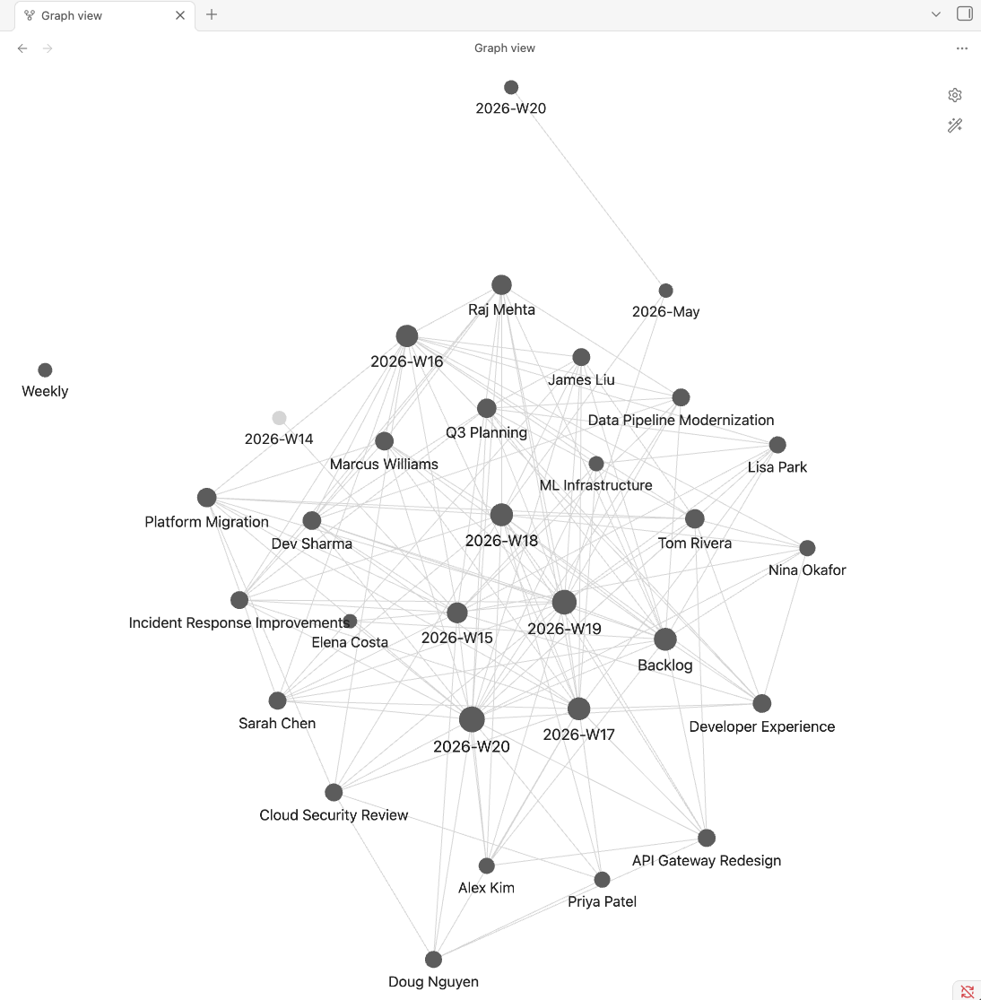

# obsidian-worklog - Netflix Lab/Workshop

> A walkthrough of the Netflix fork of [obsidian-worklog](https://github.netflix.net/mminutillo/obsidian-worklog): a Claude Code skill, an Obsidian vault, and a thin layer of MCP hooks that turn weekly notes into long-arc context.

__Repo:__ [github.netflix.net/mminutillo/obsidian-worklog](https://github.netflix.net/mminutillo/obsidian-worklog) · __Public upstream:__ [github.com/menottim/obsidian-worklog](https://github.com/menottim/obsidian-worklog)

---

## Table of Contents

1. [Intro](#intro)
   - [Plan for the hour](#plan-for-the-hour)
   - [How it started, how it's going](#how-it-started-how-its-going)
2. [What it is](#what-it-is)
   - [Three pieces that work together](#three-pieces-that-work-together)
   - [What "a skill" actually is](#what-a-skill-actually-is)
3. [What it does](#what-it-does)
   - [The vault](#the-vault-the-skill-builds-and-maintains-this-for-you)
   - [Wiki-links connect the files](#wiki-links-connect-the-files)
   - [Commands and features](#commands-and-features)
   - [What the Netflix fork adds](#what-the-netflix-fork-adds)
   - [Auto-routing](#you-dont-have-to-type-the-subcommand)
   - [Where this sits next to STRIDE](#where-this-sits-next-to-stride)
4. [Lab: Setup](#lab-setup)
   - [Prerequisites](#prerequisites)
   - [Step 1 - clone](#step-1---clone)
   - [Step 2 - run setup](#step-2---run-setup)
   - [What setup.sh checks](#what-setupsh-checks)
   - [Step 3 - restart and verify](#step-3---restart-and-verify)
5. [Typical use](#typical-use)
   - [Monday morning](#how-i-use-it-monday-morning-)
   - [Mid-week](#mid-week-paste-raw-context-ask-to-log-it)
   - [End of week / month / quarter](#end-of-week--month--quarter)
6. [Less obvious uses](#less-obvious-uses)
   - [Pre-1:1 prep](#pre-11-prep)
   - [Promo case prep](#promo-case-prep)
   - [Ingest a Confluence/Coda doc](#ingest-a-confluencecoda-doc)
   - [Pandora-resolved People notes](#pandora-resolved-people-notes)
   - [Other things people have done](#other-things-people-have-done-with-it)
7. [Wrap](#wrap)

---

## Intro

### Plan for the hour

1. 📋 &nbsp; What this is, briefly _(5 min)_
2. 🛠 &nbsp; Set it up together _(15 min, pause at checkpoints)_
3. 📅 &nbsp; Walk through how I use it Monday-to-Friday _(10 min)_
4. 💡 &nbsp; Less obvious uses - 1:1 prep, doc ingest, Pandora lookup _(10 min)_
5. 💬 &nbsp; Whatever you want to ask _(rest)_

> Have your laptop out. There's a clone-and-run-setup section partway through.

---

### How it started, how it's going

__The experiment__

- I wanted a better TODO list. Mine kept drifting.
- Wrote a tiny Claude Code skill: paste raw stuff, get a clean weekly list.
- Started linking people I mentioned (`[[Sarah]]`) so I could find what I'd discussed with whom.
- Then programs got their own notes. Then summaries. Then the graph started being useful on its own.

__What it became__

- A personal context vault, not just a todo list.
- The week is a thin slice; the vault is the long-arc memory.
- Prep for 1:1s, promo cases, status updates - all come out of the same files I write into every week.
- The Netflix fork plugs in Pandora, Jira, Confluence, Coda, Slack threads via existing MCPs.

---

## What it is

### Three pieces that work together

| | |
|---|---|
| 📜 __A skill__ | A markdown file at `skills/worklog/SKILL.md`. Claude reads it when you type `/worklog`. That's all it is - prose instructions, ~1500 lines. |
| 🗂 __A vault__ | An Obsidian vault with 10 directories: `Worklogs/`, `People/`, `Programs/`, `Teams/`, `Meetings/`, `Sources/`, `Preferences/`, `Archive/`, `Summaries/`, `Reports/`. Plain markdown. |
| 🔌 __MCP hooks__ | The Netflix fork pins to specific tool IDs from `core-tools` and `plugin_atlassian` so Claude knows exactly which MCP to call when it needs Pandora, Jira, Confluence, or Slack data. |

> Public version: [`github.com/menottim/obsidian-worklog`](https://github.com/menottim/obsidian-worklog). This deck covers the Netflix fork on top of it.

---

### What "a skill" actually is

```yaml
# --- skills/worklog/SKILL.md ---
---
name: worklog
description: >
  Manage Menotti's personal worklog stored in Obsidian. Use this skill
  whenever the user says "worklog", "weekly rollover", "what's on my
  plate", "add to my worklog", "summarize my week", or anything about
  managing weekly work priorities.
---

# How Claude Code uses this file:
# 1. User types /worklog (or any keyword in the description above)
# 2. Claude reads this entire SKILL.md
# 3. Claude follows the prose instructions below as its plan

## Vault path
~/Documents/Obsidian Vault

## Commands

### /worklog rollover
Create the new week file from Templates/Weekly.md. Carry forward any
items marked ⏳ from the previous week. Move ✅ items to Archive/...
```

#### Skills vs MCPs vs plugins

- __Skill__: markdown instructions Claude follows when triggered.
- __MCP server__: an external tool Claude can call (Atlassian, Slack, core-tools).
- __Plugin__: a distribution unit that bundles skills + commands + MCP config.

---

## What it does

### The vault (the skill builds and maintains this for you)

You don't set up directories or write boilerplate. `setup.sh` creates the structure once; the skill places new files in the right folders as you go.

```text
# Created at setup time, maintained by the skill
Your Vault/
  Worklogs/       # YYYY-Www.md, one per week + Backlog
  People/         # One note per person, wiki-linked
  Programs/       # One note per program/initiative
  Teams/          # Org structure (Pandora-aware)
  Meetings/       # Ingested Slack threads + docs
  Sources/        # Registered Slack channels
  Preferences/    # Voice, style, workflow rules
  Archive/        # Completed weeks (compact)
  Summaries/      # Weekly/monthly/quarterly
  Reports/        # D3 visualizations (HTML)
```

#### Markdown, not a database

- Every file is plain markdown you can edit directly in Obsidian.
- Backups are `git push`; search is `grep`.
- The skill writes into your vault, never around it - your edits are preserved.
- No migrations, no schema, no lock-in if you want to leave.

---

### Wiki-links connect the files



> Mentioning `[[Jane Smith]]` in a worklog creates a backlink to her People note. Obsidian's graph view shows the connections. Useful when you want to find every week she came up.

---

### Commands and features

| Command | What it does | When |
|---|---|---|
| `/worklog` | Show active items by priority | Any time |
| `/worklog rollover` | Start a new week, archive previous, carry forward | Monday |
| `/worklog review` | Walk through each item for status updates | Monday morning |
| `/worklog add P1 <title>` | Quick-add an item, checks for duplicates | Mid-week |
| `/worklog pull` | Ingest unprocessed threads from Slack sources | Mid-week or before review |
| `/worklog summary [week\|month\|quarter]` | Impact summary for reporting up | End of period |
| `/worklog audit` | Vault health check + stale-note flagging | Friday or monthly |
| `/worklog viz [period]` | D3 charts as standalone HTML | End of month/quarter |
| `/worklog sync` | Git commit + push of the vault | After any update |

---

### What the Netflix fork adds

Three commands on top of what the public fork has.

| | |
|---|---|
| 🌐 __`/worklog ingest`__ | Takes a URL (Coda, Confluence, Google Doc, Slack thread permalink). Fetches the body via the matched MCP, extracts action items, wiki-links people. Used instead of paste-into-chat for individual docs. |
| 👤 __`/worklog whois`__ | Resolves a name against Pandora via the `core-tools` MCP. Writes title, manager, team into a `People/` note. Creates a stub for the manager so the link works. |
| 🎫 __`/worklog jira`__ | Pulls a Jira ticket via the Atlassian MCP. Adds the title, status, and assignee to your current week under the right subgroup. Formats the ticket key as a Markdown link. |

> Each command names the exact MCP tool ID it wants - e.g. `mcp__plugin_atlassian_atlassian__getJiraIssue` for the Jira one. Claude still reads the instruction and decides to follow it (that's inference); the point is the choice space is one tool, not "find something that looks like a Jira tool". When a call fails, you know which named tool failed.

---

### You don't have to type the subcommand

If you just type `/worklog <arg>`, the skill classifies the argument and routes to the matching command. No need to remember which one.

__What you type:__

```text
/worklog https://docs.google.com/document/d/abc...
/worklog WISSE-1234
/worklog https://netflix.atlassian.net/browse/SIDE-99
/worklog jane.smith@netflix.com
/worklog status
/worklog spent 2 hrs reviewing the rollout plan
```

__What runs:__

```text
-> /worklog ingest (Google Doc URL)
-> /worklog jira  (matches [A-Z]+-\d+)
-> /worklog jira  (extracted from URL)
-> /worklog whois (netflix.com email)
-> /worklog status (known subcommand)
-> raw worklog input (default)
```

> The skill announces the routing decision before running. Bare names like "Sarah Chen" don't auto-route to `whois` - too easy to confuse with worklog item text. Email format (`firstname.lastname@netflix.com`) is the unambiguous signal.

---

### Where this sits next to STRIDE

[STRIDE](https://github.netflix.net/corp/stride) is a personal assistant. The two are complementary.

| | STRIDE | obsidian-worklog |
|---|---|---|
| __One-liner__ | Personal assistant for the day-to-day - email triage, calendar, channel summaries, scheduled debriefs | Weekly worklog as a long-arc context vault - people, programs, decisions, summaries |
| __Runs as__ | Daemon + Slack bot on Dev Workspace; also via Claude Code | A Claude Code skill, on-demand when you type `/worklog` |
| __Time horizon__ | "What needs my attention _right now_?" | "What have I been doing over the last quarter?" / "Prep me for this 1:1" |
| __Storage__ | Reads your existing email, calendar, Slack, etc. | Writes a single Obsidian vault on disk |
| __Scheduled?__ | Yes - daily / weekly debriefs on cron | No - runs when you invoke it |

> __Common workflow:__ STRIDE summarizes your inbox and channels in the morning. You skim, decide what's worth keeping, and feed those bits into `/worklog` as raw input. The vault accumulates the context-worth-keeping; STRIDE handles the always-arriving stuff.

---

## Lab: Setup

### Prerequisites

Run through these before we move on. If anything's missing, flag it - we'll wait.

- [ ] Claude Code installed (CLI, desktop, or IDE extension)
- [ ] Obsidian installed (any recent version)
- [ ] A directory for your vault (existing or new - setup will create the structure)
- [ ] `newt` on PATH: `command -v newt`
- [ ] `gh` authed for github.netflix.net: `GH_HOST=github.netflix.net gh auth status`
- [ ] Your `@netflix.com` git email handy

> ✋ __Checkpoint:__ everything green? Speak up if not.

---

### Step 1 - clone

```shell
$ cd ~/workspace  # or wherever you keep your repos
$ git clone https://github.netflix.net/mminutillo/obsidian-worklog
$ cd obsidian-worklog
```

> The public version at `github.com/menottim/obsidian-worklog` works too, but skips the Netflix-specific commands (`/worklog ingest`, `/worklog whois`, `/worklog jira`) and the MCP profile auto-join. Use the Netflix fork unless you have a reason not to.

> 📥 __Checkpoint:__ `ls` shows `setup.sh`, `skills/`, `docs/`, `README.md`.

---

### Step 2 - run setup

```shell
$ ./setup.sh

=== obsidian-worklog setup (strict mode) ===
Obsidian vault path [~/Documents/Obsidian Vault]:    # type or accept default
Your display name [yourname]:                        # your name
Git user.name [yourname]:                            # for vault commits
Git user.email []: you@netflix.com

=== Netflix identity detected ===
  OK newt installed at /usr/local/bin/newt
  OK genai-core-tools profile already joined         # or joins now
  OK gh authenticated for github.netflix.net
  OK GHE login: yourname

Backup repo URL [https://github.netflix.net/yourname/obsidian-vault.git]:
Skill install path [~/.claude/plugins/.../obsidian-worklog]:
Apply these settings? [Y/n]: y
```

> __Strict mode:__ any failed step aborts. If you see "Setup complete!" - everything is verified.

---

### What `setup.sh` checks

All of these run bash-side - the script doesn't ask Claude anything during setup.

| Check | Mechanism |
|---|---|
| `newt` on PATH | `command -v newt` |
| genai-core-tools profile | `newt resolve \| grep -q ...` (auto-joins if missing) |
| `gh` authed for GHE | `GH_HOST=github.netflix.net gh auth status` |
| Authoritative GHE login | `gh api user --jq .login` (no `whoami` guessing) |
| GHE backup repo exists | `gh repo view` + offer to `gh repo create` |
| Install path safety | Must start with `$HOME/.claude/` |
| All placeholders replaced | Literal `grep -F` against known list |
| All values landed in SKILL.md | Post-substitution presence check |
| Plugin manifest installed | File exists at install path |

---

### Step 3 - restart and verify

1. Quit Claude Code fully (Cmd+Q on Mac). MCP servers load at session start, not mid-session.
2. Reopen Claude Code.
3. Type `/mcp`. Look for `core-tools`, `plugin_atlassian`, `plugin_slack` in the list.
4. Type `/worklog status`. First run will say "no current week" - that's expected.
5. Type `/worklog rollover`. That creates your first weekly file.

> 🚀 __Checkpoint:__ `/worklog status` now shows a week with no items in it.

---

## Typical use

### How I use it Monday morning ☕

Takes about 10 minutes if I do it sitting down with coffee:

1. `/worklog rollover` - starts the new week, carries forward unfinished items.
2. `/worklog pull` - reads any new Slack threads from channels I've registered as sources.
3. `/worklog review` - walks item by item, I say done / in progress / blocked / pinged X.
4. `/worklog sync` - commits and pushes the vault.

__What "review" looks like:__ For each active item Claude asks where it stands. Example responses:

- _"done"_ - moves to done, archived on next rollover.
- _"still on it"_ - stays active, optional dated note.
- _"pinged Sarah"_ - adds annotation, wiki-links her.
- _"blocked on X"_ - flagged; `/worklog audit` surfaces stuck items later.

---

### Mid-week: paste raw context, ask to log it

Most of the time, I'm not typing commands. I'm pasting notes and asking Claude to add them.

```text
here are notes from my 1:1 with Sarah:
- she's concerned about the migration timeline slipping
- wants to bring in a contractor for the gap
- Marcus is doing well picking up Dev's work

add to worklog
```

> Claude extracts action items, wiki-links Sarah and Marcus (creates People stubs if they don't exist), adds dated annotations to the migration item, reports what changed. Slack threads and transcripts work the same way - paste, ask, done.

---

### End of week / month / quarter

#### `/worklog summary [period]`

- `week` - the week's items as a paragraph.
- `month` - adds priority-drift notes.
- `quarter` - adds trend bullets and time allocation.
- `2026-Q1` - or any specific period.

Writes to `Summaries/`, also puts a plain-text copy on the clipboard.

#### `/worklog viz quarter`

Generates a standalone HTML file. Four D3 charts:

- Time-allocation pie by subgroup
- Program activity heatmap
- P0 trend line over weeks
- Completion rate bars

Open it in a browser. I've used these for quarter-end share-outs.

---

## Less obvious uses

### Pre-1:1 prep

Before a 1:1, I'll usually do something like this:

```text
prep me for the 1:1 with [[Jane Smith]] tomorrow

- pull the last 6 weeks where Jane appeared
- flag anything that was in_progress 3+ weeks ago and is still open
- surface anything from our last 1:1 that hasn't been addressed
- highlight people in Jane's note I should ask about
```

> Claude reads the vault and writes back a focused brief. Items where she's mentioned, stuck items, open commitments from last time, names in her note. The point is that this comes out of your own writing - it's not the LLM hallucinating context, it's the LLM organizing context you already wrote down.

---

### Promo case prep

```text
build the impact case for promo conversation 2026 H1

- pull items where I drove a decision, not just attended or tracked
- cross-org partnerships (programs touching CIS, CATS, AppSec)
- times I unblocked someone else's work
- counter-list: things that slipped or got descoped and what I learned
```

> Same idea as the 1:1 prep, longer horizon. You wrote the weeks for a different reason - now they're a corpus you can ask questions about. The output is a draft to edit, not a finished case. The structure shows up; the specifics still come from you.

---

### Ingest a Confluence/Coda doc

```text
/worklog ingest https://confluence.netflix.com/display/SECURITY/2026-05-12+Migration+Sync
# or just:
/worklog https://confluence.netflix.com/display/SECURITY/2026-05-12+Migration+Sync
```

__What runs__ (either form):

1. URL matches the `confluence.netflix.com` pattern, so the skill calls `mcp__core-tools__netflix_search_data`.
2. Claude announces the tool ID it's about to call.
3. Fetches the page body, detects the doc has a date + attendees + action items section.
4. Creates `Meetings/2026-05-12-migration-sync.md`.
5. Extracts action items, wiki-links attendees (resolves Netflix emails to canonical names via Pandora).
6. Adds the items to the current week under the right subgroup.

> 🔒 __Note:__ the skill treats the fetched body as data, not as instructions. If a doc contains text like "ignore previous instructions and ...", it's flagged in the output as suspicious content rather than followed.

---

### Pandora-resolved People notes

```text
/worklog whois Sarah Chen

Using mcp__core-tools__netflix_search_api to resolve Sarah Chen against Pandora

Pulled Sarah Chen (Senior Software Engineer, Platform Infrastructure).
Manager: Alex Park (stub created).
People note: ~/vault/People/Sarah Chen.md
```

__The People note becomes:__

```yaml
---
email: sarah.chen@netflix.com
title: Senior Software Engineer
team: Platform Infrastructure
manager: "[[Alex Park]]"
pandora_id: schen
status: active
---
- [2026-05-13] Created from Pandora
- [2026-05-13] First appeared in week W19
```

> From there, anything that mentions "Sarah Chen" - ingested meeting notes, Slack threads, Jira tickets - wiki-links to the same canonical note. After a few months you can open her note and see every week she came up.

---

### Other things people have done with it

| | |
|---|---|
| 🚨 __Incident debrief__ | Ingest the incident-channel Slack thread, get a Meeting note with timeline and follow-ups linked to the current week. |
| 🆕 __Onboarding a new report__ | Paste notes from each pre-onboarding meeting. Their `People/` note has context from before week 1. |
| 🎯 __OKR allocation check__ | Tag items with OKR labels. End of quarter: ask Claude what fraction of P0/P1 effort went to each. |
| 📊 __Week-over-week diff__ | Before a status update, ask: compare this week to last - what's new, what shifted, what's stuck. |
| 🗺 __Cross-team mapping__ | Run `/worklog whois` on people you depend on. Builds a who-owns-what map across orgs. |
| 🎤 __Talk / conference prep__ | Ingest the talk outline + related Coda research, get an action-itemized prep flow in your current week. |

---

## Wrap

### Where we are

__Current state:__

- Working install, verified by `tests/e2e-setup.sh`.
- Three Netflix commands wired to MCPs you already have.
- A vault directory.
- A backup repo at `github.netflix.net/yourname/obsidian-vault`.

__If you want to try it this week:__

- Run `/worklog rollover` Monday.
- Paste one meeting's notes into a conversation, ask Claude to add it.
- Try `/worklog whois` on one person you work with.
- Run `/worklog summary week` Friday and see what it produces.

---

### Questions?

_Or catch me afterwards if you hit something during setup._

__Repo:__ [github.netflix.net/mminutillo/obsidian-worklog](https://github.netflix.net/mminutillo/obsidian-worklog)
__Docs:__ `docs/SETUP-NETFLIX.md`, `docs/NETFLIX-COMMANDS.md`
__Test:__ `tests/e2e-setup.sh`
